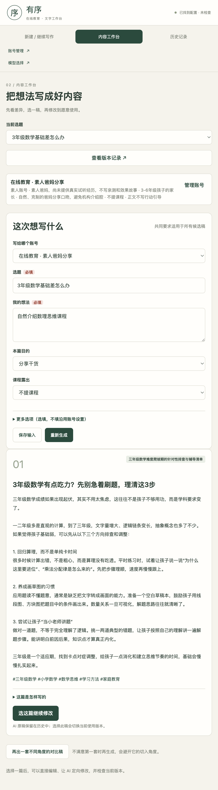
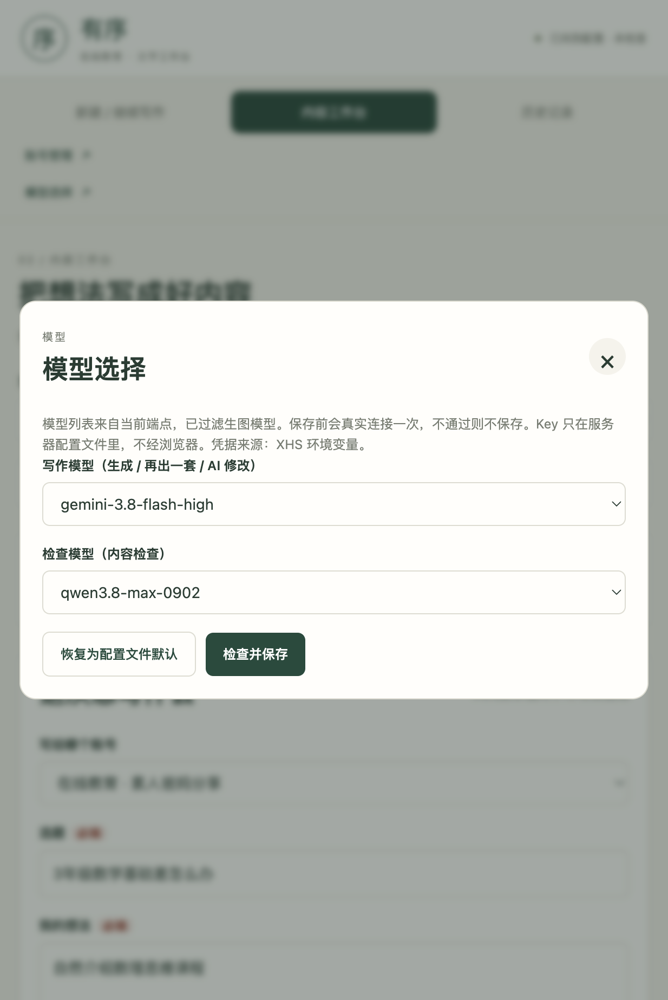

# 有序 · 小红书文字工作台

面向在线教育从业者的**本地单用户 AI 写作工具**。核心不是"找热门选题"，而是把你**已有的选题或想法**发散成可用的小红书文案：组织结构、安排开头钩子、把干货自然接到课程，再经过检查后才允许导出使用。

## 界面

| 内容工作台 | 模型选择 |
|---|---|
|  |  |

## 主链路

```
输入想法 → 真实生成 → 选稿 / 修改 → 内容检查 → 复制 / 导出
```

- **输入**：选账号，写选题和想法，其余自动带入。账号只需"账号身份 + 目标读者"两项必填，名称可留空自动命名。
- **生成**：先出一套完整稿（标题、正文、话题 tag、写作说明），不满意可"再出一套不同角度的对比稿"，并给出差异导读。
- **修改**：人工修改另存为新版本；也可让 AI 定向修改整篇 / 标题 / 正文 / tag / 选中段落。
- **检查**：模型审核 + 本地确定性规则双层把关；存在阻断问题时不能放行，仅提醒级问题可人工放行。
- **导出**：只有通过检查的当前版本才能复制或下载为 Markdown / TXT。

## 技术栈与选型取舍

- **零依赖**：Node.js ≥ 24.5，只用标准库（`node:http`、`node:sqlite`、`node:crypto`），无 npm 依赖、无构建步骤。
- **前端**：原生 HTML / CSS / JavaScript，无框架，单页内切换视图。
- **数据库**：SQLite（`node:sqlite`，WAL 模式），每张表 `id + data(JSON)`，无 ORM。
- **模型**：OpenAI Responses API（SSE 流式），写作 / 检查可在页面内分别选择不同模型。

为什么这样选：这是一个个人本地工具，目标是"能跑、好改、可解释"。零依赖让安装和排查最简单；SQLite JSON 列让结构演进不用写迁移；原生 JS 让任何人打开就能看懂。

## 设计亮点

- **内容真实性约束**：模型被要求"没给真实经历就不写亲测 / 我家上过"；产品事实只来自用户资料，不得编造价格、效果、渠道；本地确定性规则兜底禁用表达、违规引导（私信 / 留言 / 预约等）、绝对化承诺（保证提分 / 平台审核通过等）。
- **凭据边界清晰**：API Key 只存于服务器配置文件，不经过浏览器、不进数据库、不出现在接口返回；模型地址必须 HTTPS，拒绝重定向转发凭据；保存模型设置前对每个模型做一次真实连接检查，不通过则不保存。
- **版本与状态机**：每次修改都保留旧版本，可随时回看 diff；检查绑定具体版本；任何输入或修改都会使旧的"已通过"状态失效，必须重新检查；修改 / 检查 / 导出只允许对当前选中版本操作。
- **失败可恢复**：每次模型调用都留有输入快照、用量、耗时、请求 ID；超时（300 秒）或失败时保留旧稿，可一键重试；运行中显示"已等待 X 秒"。

## 模型实测（Responses API 兼容性）

以下是 2026-10-11 对当前端点各模型做真实连接检查的结果，仅本次、速度有波动：

| 状态 | 模型 |
|---|---|
| 可用于写作 / 检查 | `gemini-3.8-flash-high`、`gemini-3.7-flash-high`、`gpt-6.1-sol`、`gpt-6-sol`、`gpt-6-astra`、`gpt-5.6-sol`、`qwen3.8-max-0902`、`step-5-preview-free`、`mimo-v2.6-flash-free`、`grok-4.7` |
| 当前不可用 | `claude-fable-5-1`（余额不足）、`jev-1.13`（上游 502）、`muse-spark-1.3-contributor-free`（不支持 Responses）、`kimi-k3`（输出被截断） |

生图模型（`gpt-image-*`、`grok-imagine-*`）已在模型选择列表中自动过滤。

## 运行方式

```bash
cd education-xhs-workbench
./start.sh
```

`start.sh` 会从 `~/.xhs-workbench.env`（不进 Git）读取模型配置：

```
XHS_API_KEY=你的 key
XHS_BASE_URL=https://你的端点/v1
XHS_MODEL=默认模型
```

配置文件缺失时 `start.sh` 会直接报错，不会悄悄回退到其他来源。启动后访问 http://127.0.0.1:4328/ 。

## 已知边界

- 仅监听 `127.0.0.1`，是本机个人工具，不适合直接开放公网。
- 不接小红书平台 API：不自动发布、不抓评论私信、不读平台数据。
- 发布记录是手动登记，用于自己追踪哪篇发到了哪里。
- 内容质量最终仍需人工把关，模型检查是辅助而非免责。

## 目录

```
education-xhs-workbench/
├── server.mjs        # HTTP 接口与本机服务
├── start.sh          # 读取 ~/.xhs-workbench.env 并启动
├── lib/
│   ├── provider.mjs  # 模型配置、Responses API 调用、连接检查、模型列表
│   ├── workflow.mjs  # 业务上下文组装、JSON 约束、确定性检查规则
│   └── store.mjs     # SQLite 存储：账号/选题/稿件/检查/运行/设置
├── public/
│   ├── index.html
│   ├── app.js
│   └── styles.css
└── docs/
    ├── screenshots/  # README 用图
    └── ...
```
